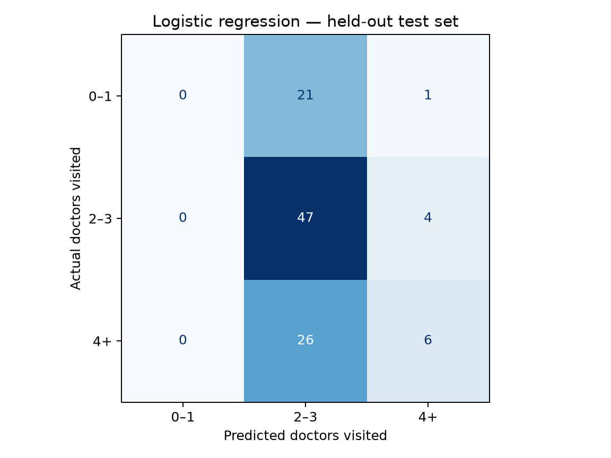

# Healthcare Utilization Prediction

A machine learning project exploring whether healthcare utilization among older adults can be predicted using survey data from the National Poll on Healthy Aging (NPHA). The project compares logistic regression and decision tree classifiers to predict the number of different doctors an individual has visited within a year. The analysis includes data preprocessing, feature selection, model evaluation, and a discussion of the limitations of the results.

**[Read the full report (PDF)](docs/original_report.pdf)**

  

